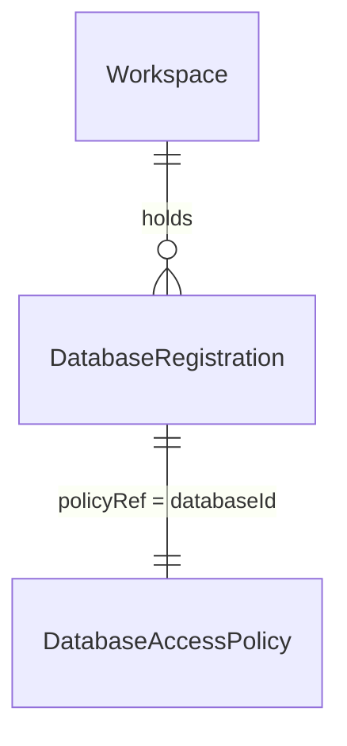

# Database registration (T3 of #235, slice 2a): register a Workspace database for probing

## Problem

A Workspace owner cannot tell Verchestra which database a probe may read. The
probe planner (`ProbePlanner.plan`) resolves every request through a database
registration and the access policy it names, and refuses without both
(`VES_DATABASE_NOT_FOUND`, `VES_PROBE_POLICY_INVALID`). Today a registration
exists only in memory: `MemoryDatabaseRegistrationStore` is the only store, no
command creates one, and the CLI does not depend on `@verchestra/data-probe`
at all. Slice 1 (#681) lets an owner register and approve a probe worker; with
nothing to point it at, slice 2b's `vestra probe run` has no database to plan
against.

The owner split slice 2 on 2026-10-28: 2a persists registrations, 2b runs a
probe under a per-run confirmed grant. The source gives no usage figure; this
is a post-1.0 surface (AD-017's edge model).

When 2a ships, the owner can register a database and its access policy in the
Workspace, list registrations with whether each still verifies, and remove one.
Nothing connects to a database.

## Flow

This reuses the data-probe package's registration and policy validation, slice
1's Workspace evidence key sealing and verification, and the CLI's command
dispatch, instead of a second implementation of any of them.

1. `vestra database <add|list|remove>` -> `apps/vestra-cli` `main.ts` dispatch (exists) -> the command family's handlers in `apps/vestra-cli/src/database/` (new, no door - placement per the `extension` family's conventions)
2. `add`: the definition file (door 3) -> `normalizeDatabaseRegistration` (exists) with the Workspace's own id and `policyRef` set to the database id, and `normalizeDatabaseAccessPolicy` (exists as the module-private `normalizePolicy`, exported by this change) -> sealed by the Workspace evidence key exactly as slice 1 seals the skill lock (`extension-seal.ts`, exists) -> `.verchestra/databases/<databaseId>.json` written with an exclusive create (door 1)
3. `list`: reads `.verchestra/databases/` and verifies each envelope as slice 1 verifies the lock (exists), then re-validates its body
4. `remove`: deletes one registration file
5. `WorkspaceDatabaseRegistrationStore` (door 2) implements `DatabaseRegistrationStorePort` (exists) over the same files for slice 2b's planner, returning only registrations that verify
6. out: one JSON envelope per command; no database is contacted

## Impact

| Front | What changes |
| --- | --- |
| domain | existing term: `database registration` was an in-memory value only tests and the planner's fixtures build; it becomes a signed Workspace document. `CanonicalDatabaseRegistration` (`machine-bootstrap.ts`, read only by `self-test`) is a different shape and is unchanged |
| domain | new term: `database definition` - the file an owner writes and `add` reads; never stored as written |
| package boundary | `apps/vestra-cli` gains the workspace dependency `@verchestra/data-probe` (a link, no external package); `@verchestra/data-probe` exports `normalizeDatabaseAccessPolicy` |
| evidence | `packages/evidence` declares the predicate type `database-registration/v1` |
| CLI surface | three commands join the release command manifest, so every pinned command list changes with them: `cli-surface`, the `--help` snapshot in `cli-launchers-e2e`, and `SEALED_COMMANDS` in `sealed-launcher-closure` (lesson L-019) |
| stored data | nothing migrates: `.verchestra/databases/` is new |

## Relations

One-way constraints: one registration per `databaseId` per Workspace (door 1);
a registration is never edited in place - `add` refuses different content for
an existing id (door 1); a registration's policy is its own, `policyRef` equal
to its `databaseId` (door 1). No columns and no types here.

## Surface

| Route | In | Out | Status |
| --- | --- | --- | --- |
| `vestra database add` | `--definition`, and the credential flags `extension add` takes | `databaseId` · `registrationDigest` · `created` | `exit 0`, `exit 2`, `exit 5` |
| `vestra database list` | none | `databases[]` of `databaseId` · `engine` · `logicalEnvironment` · `classification` · `production` · `registrationDigest` · `state` | `exit 0`, `exit 5` |
| `vestra database remove` | `--database` | `databaseId` · `removed` | `exit 0`, `exit 2`, `exit 5` |

Every command also takes `--output json`, as every command does.

## Landing

| One-way door | Literal shape | Alternative rejected |
| --- | --- | --- |
| 1. Registration document | `.verchestra/databases/<databaseId>.json` is a DSSE envelope, predicate type `https://accd.github.io/verchestra/attestation/database-registration/v1`, body `{registration, policy, registeredAt}` where `registration` is the normalized `DatabaseRegistration` with its `registrationDigest` and `policy` the normalized `DatabaseAccessPolicy` with `policyRef` equal to `databaseId`; signed like slice 1's lock (Workspace evidence key, `approval` purpose, pinned trust anchor); created with an exclusive create, never rewritten | a runtime SQLite table - a registration is Workspace configuration a reviewer reads in the repository, and every authority table requires a run; an unsigned file - the planner trusts the policy's bounds, so an edited `maxRows` or `allowedObjects` must stop verifying; a policy file shared by several databases - nothing needs sharing yet, and one file keeps each database's review in one place |
| 2. Store adapter | `WorkspaceDatabaseRegistrationStore` implements the existing `DatabaseRegistrationStorePort` (`save`, `load`, `list`) over door 1's files; `load` and `list` return only registrations whose envelope verifies and whose body re-validates | a second registry API beside the port - slice 2b's `ProbePlanner` already takes a `DatabaseRegistry` over that port |
| 3. Definition file | `vestra database add --definition <file>` reads JSON `{schemaVersion: 1, database: {databaseId, engine, logicalEnvironment, classification, approvedSchemas, schemaSourceRefs, allowedPurposes, logicalCredentialName, production}, policy: {allowedObjects, allowedFunctions, deniedFunctions, allowCatalogAccess, maxTimeoutMs, maxRows, maxBytes, maxConcurrency}}`, at most 64 KiB, exact keys; the CLI supplies `workspaceId` and `policyRef` | one flag per field - seventeen fields, seven of them arrays, make a command line nobody can review; reading the DSSE body itself - an owner would have to write the derived `workspaceId`, `policyRef` and `registrationDigest` |
| 4. CLI command family | `vestra database <add|list|remove>` in the release command manifest | `vestra probe database ...` - `vestra probe` is reserved for slice 2b's run (slice 1, door 5) |

- Nothing else in this change is hard to reverse

## Criteria

### S1: an owner registers, lists and removes a Workspace database (P1)

The owner records which database a probe may read, under which policy, and sees
whether each record still verifies; nothing connects to a database.

**Acceptance Criteria**

1. WHEN `vestra database add --definition <file>` names a valid definition THEN the system SHALL write `.verchestra/databases/<databaseId>.json` whose envelope verifies against the pinned Workspace trust anchor, whose `registration` equals `normalizeDatabaseRegistration` of the definition with this Workspace's id and `policyRef` equal to `databaseId`, and SHALL print `databaseId`, `registrationDigest` and `created: true`
2. IF the definition fails registration validation THEN `vestra database add` SHALL refuse with exit 5 and the code the validator raised (`VES_DATABASE_REGISTRATION_INVALID` or `VES_DATABASE_ENGINE_UNSUPPORTED`) and write nothing
3. IF the definition's policy fails validation THEN `vestra database add` SHALL refuse with exit 5 and `VES_PROBE_POLICY_INVALID` and write nothing
4. IF the definition file is missing, larger than 64 KiB, not JSON, or has keys other than the definition's THEN `vestra database add` SHALL refuse with exit 2 and write nothing
5. IF `logicalCredentialName` is not a name `vestra secret set` accepts THEN `vestra database add` SHALL refuse with exit 5 and `VES_DATABASE_REGISTRATION_INVALID` and write nothing
6. IF a registration for the same `databaseId` exists with a different `registrationDigest` or policy THEN `vestra database add` SHALL refuse with exit 5 and `VES_DATABASE_REGISTRATION_CONFLICT` and leave the existing file byte-identical
7. IF a registration for the same `databaseId` exists with the same registration and policy THEN `vestra database add` SHALL exit 0 with `created: false` and leave the file byte-identical
8. The system SHALL create a registration file with an exclusive create, so that of two concurrent `add` calls for one `databaseId` with different content exactly one file is written and the other call is refused with `VES_DATABASE_REGISTRATION_CONFLICT`
9. WHEN `vestra database list` runs THEN the system SHALL print one entry per file under `.verchestra/databases/`, ordered by `databaseId` in code-unit order, with `state` `valid`
10. IF a registration file's envelope does not verify, its body fails validation, its `workspaceId` is not this Workspace's, or its file name differs from its `databaseId` THEN `vestra database list` SHALL report it with `state` `invalid` and exit 0
11. WHEN no registration exists THEN `vestra database list` SHALL print an empty `databases` array and exit 0
12. WHEN `vestra database remove --database <id>` names a registered database THEN the system SHALL delete its file and print `databaseId` and `removed: true`
13. IF `vestra database remove` names a database with no registration file THEN the system SHALL refuse with exit 5 and `VES_DATABASE_NOT_FOUND`
14. The system SHALL return from `WorkspaceDatabaseRegistrationStore.load` and `list` only registrations that `vestra database list` would report `valid`
15. The system SHALL contact no database and start no process during any `vestra database` command

**Independent test:** in a disposable Workspace, `add` a PostgreSQL definition (exit 0, `created: true`), `add` it again (exit 0, `created: false`), `add` a changed policy for the same id (exit 5, conflict), `list` (one `valid` entry), edit the file's `maxRows` and `list` again (`invalid`), `remove` it and `list` (empty).

## Out of scope

| Excluded | Why |
| --- | --- |
| `vestra probe run` and its per-run confirmed grant | slice 2b (owner decisions, 2026-10-28) |
| Editing a registration in place | a registration is immutable; `remove`, then `add` the changed definition |
| One access policy shared by several databases | no consumer needs it; each registration carries its own policy |
| Checking connectivity, or that the logical credential is bound, at `add` | `add` contacts nothing; `vestra secret status` already reports a binding |
| Delivering a database credential to an out-of-process probe worker | excluded by the probe host's spec (`out-of-process-probe-host/spec.md`, Out of scope) |
| Importing the bootstrap `CanonicalDatabaseRegistration` | a different shape with one consumer, `self-test` |

## Assumptions

| Assumption | Chosen default | Rationale | Confirmed? |
| --- | --- | --- | --- |
| Slice 2 is cut in two | 2a registers databases; 2b runs a probe under a per-run confirmed grant | owner decision, 2026-10-28 | y |
| Where registrations live | in the repository, `.verchestra/databases/`, beside the skill lock | Workspace configuration a team reviews; the same place and trust model as slice 1's lock | n |
| `remove` leaves no record | the file is deleted; version control keeps its history | no reader needs a tombstone until a probe run references a registration (2b) | n |
| Platforms | `vestra database` runs on Linux, macOS and Windows | it starts no process; only the probe host is POSIX-only | n |

**Open questions:** none - all resolved or logged above.

## Observable

| Surface | Decision | Landing |
| --- | --- | --- |
| all `vestra database *` | output format and verbosity | existing - the public JSON envelope with `--output json`, human text otherwise |
| `vestra database add` | every flag and its default | AC 1, AC 4; door 3 (definition file) |
| `vestra database remove` | every flag and its default | AC 12 |
| all `vestra database *` | exit codes | Surface; AC 2-6, AC 13 |
| `vestra database add` | what it prints when it fails halfway | AC 2-6, AC 8 (nothing is written unless the exclusive create succeeds) |
| `vestra database remove` | what it prints when it fails halfway | AC 13 |
| `vestra database list` | empty state | AC 11 |
| `vestra database list` | ordering | AC 9; code-unit order (repository rule) |
| `vestra database list` | duplicates | n/a - one file per `databaseId` (door 1) |
| `vestra database add` | duplicates | AC 6, AC 7 |
| `vestra database list` | the exception that does not fit | AC 10 (`invalid`) |
| `vestra --help` and `vestra database --help` | document the reader acts on | existing - command help from the release command manifest |

## Sources

- Owner decisions, 2026-10-28: slice 2 is cut into 2a (registrations) and 2b (a probe run whose grant is confirmed per run)
- `.specs/features/probe-host-composition/plan.md` - slice 1's doors 1-2 (the lock's place and signature) and Out of scope ("Database registration persistence")
- `packages/data-probe/src/index.ts` - `DatabaseRegistrationInput`, `normalizeDatabaseRegistration`, `DatabaseRegistrationStorePort`, `DatabaseAccessPolicy`
