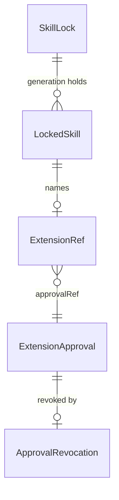

# Probe host composition (T3 of #235), slice 1: register, approve and check a workspace probe worker

## Problem

A Workspace owner cannot use the out-of-process probe host. Its containment is
qualified (#235, #569, #570) and the owner ratified AD-037 on 2026-10-28, but
nothing a user runs reaches it: no command runs a workspace probe worker, and
nothing in the product can produce what admission requires. Admission accepts
a worker only from a skill lock whose signature verifies, an approval of the
worker's exact launch that is on record, unrevoked and unexpired, and a
controller grant. Today:

- the only lock on disk is the placeholder `init` writes
  (`{"schemaVersion":1,"skills":[]}`), which the registry refuses: it has no
  generation, digest or signature, and no production lock verifier exists;
- `approvalRef` names a record nobody stores: there is no approval store;
- nobody issues a grant.

A team that implements a probe in its own repository (AD-017's edge model)
therefore has no governed way to run it through Verchestra. The source gives
no usage figure; this is a post-1.0 surface.

When slice 1 ships, the owner can register a workspace probe worker in a
signed lock, approve its launch on this machine, list and revoke approvals,
and check that the worker would be admitted, with nothing spawned. Slice 2,
`vestra probe run`, executes it under a grant recorded as a run (owner
decision, 2026-10-28) and is planned separately.

## Flow

This reuses the skill registry's lock validation and update, the host's
admission, the launch-digest measurement, the Workspace evidence key with its
pinned trust anchor, and DSSE sealing, instead of a second implementation of
any of them.

1. `vestra extension <add|approve|list|revoke|check>` -> `apps/vestra-cli` `main.ts` dispatch (exists) -> an extension command module (new, placement per conventions)
2. `add`: entry file and declared metadata -> `GovernedSkillRegistry.planUpdate` and `activate` (exists) through a file lock store (door 1) and a Workspace-key lock verifier (door 2) -> writes the next lock generation to `.verchestra/skills.lock.json`
3. `approve`: `GovernedSkillRegistry.resolveExecutableExtension` (exists) resolves the entry; `probeLaunchDigest` (exists) measures the launch on this host; local human confirmation, as `task approve` asks (exists) -> a signed approval record (door 3) in the Workspace state
4. `list`, `revoke`: the approval store (door 3) reads records, or writes a signed revocation
5. `check`: `WorkspaceProbeAdmission.admit` (exists) with the production lock and approval ports and no grant; reaching `VES_EXECUTION_GRANT_REQUIRED` means every earlier prerequisite passed; the measured launch digest is compared with the approval's
6. out: one JSON envelope per command; nothing is spawned; the composition guard admits only this path (door 4)

## Impact

| Front | What changes |
| --- | --- |
| domain | new term: `extension approval` - a signed, expiring, revocable human approval of one workspace probe worker launch on one machine, stored under the lock's `approvalRef`. It is not an `ApprovalRecord` (a run-scoped action approval in the authority store) |
| domain | existing term: `.verchestra/skills.lock.json` was a placeholder only `task plan` read, hashing its raw bytes (`task-plan.ts:241-244`); after `extension add` it is a signed lock, so a task bound before an `add` no longer matches its plan - `task plan` and `task approve` branch on that digest |
| stored data | nothing migrates: the placeholder is replaced by generation 1 on the first `add`; approvals are new files |
| package boundary | `@verchestra/extension-host` gains an `exports` map (it has none, and the guard's resolver requires one) and becomes a CLI dependency; `docs/repository-map.md` is corrected where it lists dependencies the package does not declare |
| architecture guard | `tests/architecture/extension-host-composition.test.mjs` moves from zero edges to an allowlist (door 4) |

## Relations

One-way constraints: an `approvalRef` has at most one approval record, and a
second `approve` for it is refused while the first is unrevoked (door 3); an
approval binds exactly one component digest and one launch digest (door 3);
the lock's generation only increases (existing registry rule). No columns and
no types here.

## Surface

| Route | In | Out | Status |
| --- | --- | --- | --- |
| `vestra extension add` | `--skill`, `--extension`, `--entry`, `--approval-ref`, `--version`, `--license` | `lockDigest` · `generation` · `skillId` · `extensionId` · `approvalRef` | `exit 0`, `exit 2`, `exit 5` |
| `vestra extension approve` | `--approval-ref`, `--executable`, `--arg` (repeatable), `--env` (repeatable), `--expires` | `approvalRef` · `extensionId` · `componentDigest` · `launchDigest` · `expiresAt` | `exit 0`, `exit 2`, `exit 5` |
| `vestra extension list` | none | `approvals[]` of `approvalRef` · `extensionId` · `componentDigest` · `launchDigest` · `expiresAt` · `state` | `exit 0`, `exit 5` |
| `vestra extension revoke` | `--approval-ref` | `approvalRef` · `revokedAt` | `exit 0`, `exit 2`, `exit 5` |
| `vestra extension check` | `--approval-ref` | `checks[]` of `id` · `status` · `code` · `recovery` | `exit 0`, `exit 2`, `exit 4`, `exit 5` |

Every command also takes `--output json`, as every command does.

## Landing

| One-way door | Literal shape | Alternative rejected |
| --- | --- | --- |
| 1. Lock file | `.verchestra/skills.lock.json` holds a `SkillLock` (`schemaVersion: 1`, `generation`, `skills`, `lockDigest`, `signature`); `activate` replaces it atomically, keeping the previous generation as `skills.lock.<generation>.json` for rollback | a lock in the runtime SQLite store - the lock is Workspace content a reviewer reads in the repository, and `task plan` already hashes this file |
| 2. Lock signature | `signature` is a DSSE envelope over the lock's canonical body without `lockDigest` and `signature`, predicate type `https://accd.github.io/verchestra/attestation/skill-lock/v1`, signed by the Workspace evidence key (`workspace-task-evidence`) under its existing `approval` purpose and verified against the pinned trust anchor; each skill's `source.signature` is the same envelope over that skill's `source` and `contents` | a new key purpose - `EncryptedFileKeyProvider` refuses a stored key whose purposes differ from the requested set (`encrypted-file-key-provider.ts:124`), so adding one breaks every existing Workspace key; a second key - a second passphrase and anchor for one human |
| 3. Approval record | `<Workspace state>/extension-approvals/<approvalRef>.json` is a DSSE envelope, predicate type `https://accd.github.io/verchestra/attestation/extension-approval/v1`, body `{approvalRef, extensionId, lockDigest, componentDigest, launchDigest, launch:{executable, args, environment}, approvedAt, expiresAt}`, signed like door 2; a revocation is `<approvalRef>.revoked.json`, a DSSE envelope over `{approvalRef, revokedAt}` with predicate type `.../extension-approval-revocation/v1`; the lookup port returns an approval only when both verify, it is unexpired, and no revocation exists | an `authority_approvals` row - every authority record needs a run (`runtime-migrations.ts:122-148`), and an extension approval outlives runs; an unsigned file - the approval port must return only approvals it verified (AD-037) |
| 4. Composition guard | the walk allows edges into `@verchestra/extension-host` only from the extension command module, and only to `WorkspaceProbeAdmission` and its types; `FramedProbeWorker`, `ProbeWorkerSupervisor` and `SpawnedProbeWorker` stay unreachable until slice 2 | deleting the guard - slice 1 composes admission only, and nothing should be able to spawn a worker before slice 2's grant exists |
| 5. CLI command family | `vestra extension <add|approve|list|revoke|check>` in the release command manifest | `vestra skill ...` - the governed skill commands (profiles, replacement) are a different surface; `vestra probe ...` - reserved for slice 2, which runs probes |

- Nothing else in this change is hard to reverse

## Criteria

### S1: an owner registers, approves, lists, revokes and checks a workspace probe worker (P1)

The owner takes a probe worker from their repository to "would be admitted",
with nothing executed.

**Acceptance Criteria**

1. WHEN `vestra extension add` names an entry file inside the Workspace THEN the system SHALL write the next lock generation with one skill whose `extensionRef` carries the given extension id and approval ref, whose entry digest is the file's sha256, and whose lock and source signatures verify against the pinned Workspace trust anchor, and SHALL print `lockDigest` and `generation`
2. IF the lock on disk is the `init` placeholder THEN `vestra extension add` SHALL write generation 1 in its place
3. IF the entry path leaves the Workspace or names a link THEN `vestra extension add` SHALL refuse with exit 5 and change nothing
4. WHEN `vestra extension approve` runs after the owner confirms the shown component and launch digests THEN the system SHALL write a signed approval binding the lock's extension, the entry's digest and the launch digest `probeLaunchDigest` measures for the given executable, arguments and environment, with `expiresAt` from `--expires`
5. IF the owner does not confirm THEN `vestra extension approve` SHALL write nothing and exit 5
6. IF an unrevoked approval already exists for the approval ref THEN `vestra extension approve` SHALL refuse with exit 5 and leave the existing record unchanged
7. IF `--env` names a reserved, secret-like or loader variable THEN `vestra extension approve` SHALL refuse with the code `SpawnedProbeWorker` uses for that variable, before measuring anything
8. WHEN `vestra extension list` runs THEN the system SHALL print every approval with `state` `active`, `expired` or `revoked`, and SHALL mark as `invalid` a record whose signature does not verify
9. WHEN `vestra extension revoke` names an active approval THEN the system SHALL write a signed revocation, after which `list` reports it `revoked` and `check` fails it
10. WHEN `vestra extension check` finds the lock verified, the extension resolved, the approval active and matching, and the launch digest measured now equal to the approved one THEN the system SHALL report every check `pass` and exit 0
11. IF any `check` prerequisite fails THEN the system SHALL report that check `fail` with the specific code admission or the launch measurement raised and its recovery, and exit 4
12. The system SHALL treat admission's `VES_EXECUTION_GRANT_REQUIRED` in `check` as the one expected outcome, and any other admission code as the failing prerequisite it names
13. IF `approve` or `check` runs on Windows THEN the system SHALL refuse with `VES_PROBE_HOST_PLATFORM_UNSUPPORTED` and exit 5
14. The system SHALL start no workspace probe worker during any `vestra extension` command
15. IF an approval file was edited after signing THEN its lookup SHALL return nothing, and `check` SHALL fail with `VES_PROBE_WORKSPACE_TRUST_APPROVAL`
16. The system SHALL allow imports of `@verchestra/extension-host` reachable from the CLI only to `WorkspaceProbeAdmission` and its types, from the extension command module

**Independent test:** in a disposable Workspace, `add` a reference worker, `approve` it, `check` it (exit 0), edit the worker's entry and `check` again (exit 4, component digest), `revoke` it and `check` again (exit 4, approval).

## Out of scope

| Excluded | Why |
| --- | --- |
| `vestra probe run` and grant issuance | slice 2; its grant is a `CapabilityGrant` in the authority store under a run row (owner decision, 2026-10-28) |
| Database registration persistence | slice 2 needs it to plan a probe; slice 1 executes nothing |
| Importing a skill from a remote repository | slice 1 registers a worker from the Workspace's own repository only |
| Windows support | the host is POSIX-only (AD-037) |
| A second human approving | no second custodian exists (release custody O1) |

## Assumptions

| Assumption | Chosen default | Rationale | Confirmed? |
| --- | --- | --- | --- |
| The skill record `add` writes | `source.repository` is the Workspace's origin URL, `source.commit` its `HEAD`, `source.treeDigest` the sha256 of the entry, `contents` the single entry as `declaredClass: "executable"`, `lifecycleOwners: []`, `hooks: []`, `after: []`, `schemaCompatibility` `{1, 1}`, `minimumHarnessVersion` the CLI's version | the smallest `LockedSkill` the registry accepts for one executable entry | n |
| The license `add` requires | `--license` must name one of the registry's `allowedLicenses` | the registry already enforces an allowlist | n |
| The default approval expiry | 30 days when `--expires` is absent; at most 365 days | an approval is a standing authority over code that can change; a bound keeps it reviewed | n |
| The confirmation mechanism | the same local human confirmation `task approve` uses (AD-040) | one confirmation pattern for one human | n |
| Where approvals live | the Workspace state root that already holds the evidence key | one place per Workspace for authority material | n |

**Open questions:**

| # | Kind | Question | Until answered |
| --- | --- | --- | --- |
| 1 | open | Should `check` also run the worker's `hello` handshake in a spawned process? | slice 1 spawns nothing (AC 14); the handshake is proven in slice 2 |

## Observable

| Surface | Decision | Landing |
| --- | --- | --- |
| all `vestra extension *` | output format and verbosity | existing - the public JSON envelope with `--output json`, human text otherwise |
| `vestra extension add` | every flag and its default | AC 1, AC 2; assumptions (record shape, license) |
| `vestra extension approve` | every flag and its default | AC 4, AC 7; assumption (expiry) |
| `vestra extension check` | every flag and its default | AC 10 |
| all `vestra extension *` | exit codes | Surface; AC 3, AC 5, AC 6, AC 11, AC 13 |
| `vestra extension add` | what it prints when it fails halfway | AC 3; `activate` stages and rolls back (existing registry rule) |
| `vestra extension approve` | what it prints when it fails halfway | AC 5, AC 6 |
| `vestra extension revoke` | what it prints when it fails halfway | AC 9 |
| `vestra extension check` | what it prints when it fails halfway | AC 11 |
| `vestra extension list` | empty state | AC 8 (an empty `approvals` array, exit 0) |
| `vestra extension list` | ordering | AC 8; ordered by `approvalRef` in code-unit order (repository rule) |
| `vestra extension list` | duplicates | n/a - one record per `approvalRef` (door 3) |
| `vestra --help` and `vestra extension --help` | document the reader acts on | existing - command help from the release command manifest |

## Sources

- `.specs/STATE.md` AD-037 (ratified 2026-10-28) and AD-017 - admission rules and the edge model
- `.specs/features/out-of-process-probe-host/` T3 and `threat-model.md` - the approval adapter and grant issuance are T3's
- Owner decisions, 2026-10-28: slice 1 is register, approve and check; the slice 2 grant is recorded as a run in the authority store
