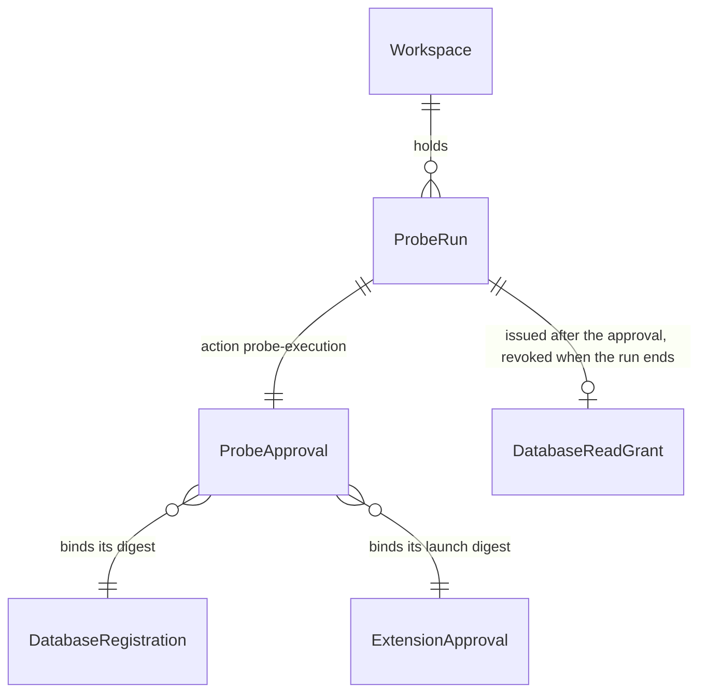

# Probe run (T3 of #235, slice 2b): run one governed read-only probe

## Problem

A Workspace owner can register a database (slice 2a, #686) and register and
approve a probe worker (slice 1, #681), but cannot run a probe. No command
composes the probe planner, the authority store and the probe host:
`ProbeWorkerSupervisor`, `FramedProbeWorker` and `SpawnedProbeWorker` are
reached only by tests; the probe host's `WorkspaceProbeWorkerGrant` has no
issuer; `CapabilityBroker` has never issued a `database-read` grant; and the
`runs` table admits only `feature` and `recovery` runs, while an authority
approval needs a run row. Until this ships, the governed probe path exists only
as tested parts.

The owner decided on 2026-10-28 that each probe run is confirmed by the owner,
who types its digest back (AD-040), and that the existing `CapabilityBroker`
then issues the grant under a run in the authority store. On 2026-10-29 the owner
chose a governed run that delivers no database credential, and a new `probe` run
kind. The source gives no usage figure; this is a post-1.0 surface (AD-017).

When 2b ships, the owner runs one read-only statement against a registered
database through an approved worker: Verchestra shows what the run will do, the
owner types its digest back, and Verchestra records the approval and a single-use
grant under a `probe` run, runs the statement in the admitted worker, and prints
the result envelope. Verchestra delivers no database credential: the worker
reaches the database with what its approved launch gives it - for the path this
slice qualifies, the path of a SQLite file.

## Flow

This reuses slice 2a's registration document, slice 1's lock, extension approval
and admission, the authority store's run, approval recorder and
`CapabilityBroker`, AD-040's typed-back confirmation, data-probe's planner and
SQLite parser, and the probe host's supervisor, framed protocol and spawned
transport, instead of a second implementation of any of them.

1. `vestra probe run --database <id> --approval-ref <ref> --request <file>` -> `apps/vestra-cli` `main.ts` dispatch (exists) -> the command family's handler in `apps/vestra-cli/src/probe/` (new, no door - placement per the `extension` and `database` families)
2. the platform guard (exists, slice 1's `refuseUnsupportedPlatform`) refuses Windows; the request file (door 4) is read; `DatabaseRegistrationFiles.evaluate` (exists) returns the registration and its policy; the engine must be `sqlite`, and `parseSqliteReadOperation` (exists) turns the SQL into the normalized operation and its protected request
3. the skill lock and `ExtensionApprovalStore.lookup` (exist) return the worker's locked entry and approved launch; `ProbePlanner.plan` (exists) checks purpose, objects and bounds against the policy before any run exists
4. the signing passphrase is read from the OS credential store (exists); `RuntimeStore.createRun` (exists) creates a run of kind `probe` (door 1) and requests an approval with action `probe-execution` and the probe binding (door 2); the review is printed and `confirmDigest` (exists) waits for the binding digest
5. `ApprovalRecorder` (exists) records the signed approval; the run moves to `EXECUTION_AUTHORIZED`; `CapabilityBroker.grant` (exists) issues the `database-read` grant under the probe policy view (door 3)
6. `ProbePlanner.plan` (exists) plans again with the grant's id as `grantRef`; `WorkspaceProbeAdmission.admit` (exists) admits the worker with the grant mapped (door 3); `ProbeWorkerSupervisor` (exists, and now compares the plan's `grantRef` with the admitted grant's) runs the statement over `FramedProbeWorker` and `SpawnedProbeWorker` (exist)
7. `CapabilityBroker.revoke` (exists) revokes the grant; the run ends `COMPLETED` through `COMPLETE_PROBE` (door 1) or `FAILED`
8. out: `runId`, `approvalId`, `grantId` and the supervisor's result envelope, which carries no rows

## Impact

| Front | What changes |
| --- | --- |
| domain | existing term: `run kind` was `feature` or `recovery`; it gains `probe`. Code that branches on it today: `workflow-machine.ts` (`COMPLETE_RECOVERY`), `run-capsule.ts` (validates the kind), `handoff/normalize.ts`, `verification/verification.ts`, `runtime-store.ts`, and the `vestra task` commands that read a run |
| domain | existing term: `approval action` gains `probe-execution`; `bindingFrom` validates it, and nothing stores a CHECK on it |
| domain | new term: `probe run` - a run of kind `probe`: one approved statement through one admitted worker under one single-use `database-read` grant |
| stored data | migration `013_probe_runs` rebuilds `runs` (door 1); every existing row is copied unchanged and the eight tables that reference `runs` keep their rows. As with every migration, an older binary refuses the migrated store. The migration count is pinned in three tests |
| package boundary | `packages/extension-host`: the supervisor refuses a plan whose `grantRef` differs from the admitted grant's. The CLI composes the supervisor, the framed protocol and the spawned transport for the first time, so slice 1's composition guard and slice 2a's data-probe guard each admit the probe family |
| evidence | the run capsule validator accepts the kind `probe`; a probe run needs no terminal capsule |
| CLI surface | one command joins the release command manifest, so every pinned command list changes with it (lesson L-019) |

## Relations

One-way constraints: a probe run's kind is `probe` (door 1); a probe run has at
most one approval and at most one grant, and the grant is revoked when the run
ends (doors 2 and 3). No columns and no types here.

## Surface

| Route | In | Out | Status |
| --- | --- | --- | --- |
| `vestra probe run` | `--database`, `--approval-ref`, `--request`, `--confirm-stdin`, `--keychain` | `runId` · `approvalId` · `grantId` · `result` | `exit 0`, `exit 2`, `exit 5` |

The command also takes `--output json`, as every command does.

## Landing

| One-way door | Literal shape | Alternative rejected |
| --- | --- | --- |
| 1. Probe run kind | migration `013_probe_runs` rebuilds `runs` with `run_kind TEXT NOT NULL CHECK (run_kind IN ('feature', 'recovery', 'probe'))` and every other column and constraint of `001_runtime` unchanged: create `runs_next`, copy every row, drop `runs`, rename `runs_next` to `runs`, as a migration the runner marks a table rebuild: it sets `PRAGMA foreign_keys=OFF` before the migration's transaction, rolls back unless `PRAGMA foreign_key_check` is empty, and turns foreign keys back on in every case; the workflow gains the event `COMPLETE_PROBE`, `EXECUTION_AUTHORIZED` -> `COMPLETED`, accepted only for a `probe` run, and a `probe` run accepts no implementation, verification or review event | reusing `feature` (owner, 2026-10-29) - the `vestra task` commands would act on a probe run, and a feature run completes only through implementation, verification and human review; a separate `probe_runs` table - `authority_approvals` and `authority_grants` reference `runs(run_id)`; editing the CHECK through `writable_schema` - unsupported by SQLite and unrecoverable on a mistake |
| 2. Probe approval | `APPROVAL_ACTIONS` gains `probe-execution`; the binding's `packageDigest` is the statement fingerprint, `sourceStateDigest` the registration digest, `policyDigest` the probe policy view's digest, and the three context digests the digest of the canonical `{}`; the review lists are `scope` [`database:<databaseId>`], `dataAccess` [`<schema>.<name>` per object], `capabilities` [`database-read`], `selectedPassports` [`<extensionId>`], `budgets` [`rows:<n>`, `bytes:<n>`, `timeout-ms:<n>`, `concurrency:<n>`], `evidenceRefs` [`registration:<digest>`, `launch:<digest>`], and every other list [`not-applicable`]; the owner types the request's binding digest | reusing `execution` - a probe approval would satisfy any check keyed on a task approval's action; typing the plan digest - it covers `grantRef`, which exists only after the approval |
| 3. Probe grant | `CapabilityBroker.grant` with principal `Vestra::Actor::"<approver>"`, action `Vestra::Action::"database-read"`, resource `Vestra::Database::"<databaseId>"`, capability `database-read`, constraints `databaseId`, `registrationDigest`, `statementFingerprint`, `extensionId`, `launchDigest`, expiring 10 minutes after issue, under a built-in probe policy view whose only policy is `permit(principal, action == Vestra::Action::"database-read", resource) when { context.approved };`; mapped to `WorkspaceProbeWorkerGrant` as `grantRef` = the grant id, `approvalRef` = the extension approval reference, `componentDigest` = the locked entry digest, `launchDigest`, `capabilities` [`database-read`], `isolationProfile` `process-contained`, `risk` `approved-workspace-executable`; revoked by the command when the run ends | one grant reused across runs - the owner confirms each run (2026-10-28); the task policy view - its schema has no database resource, and a probe grant must not satisfy a task check |
| 4. Request file | `vestra probe run --request <file>` reads JSON `{schemaVersion: 1, purpose, sql, parameters, bounds: {timeoutMs, rowLimit, byteLimit, concurrencyLimit}}`, at most 64 KiB, exact keys; the CLI supplies `workspaceId`, `requestId`, `databaseId`, `protectedRequestRef`, `grantRef` and the normalized operation | a pre-normalized operation in the file - the owner would write derived fields, and the engine's parser is where its denial rules live; one flag per field - SQL and parameters on a command line end up in shell history |
| 5. CLI command | `vestra probe run` in the release command manifest | `vestra database probe` - slice 1's door 5 reserved `vestra probe` for this run |

- Nothing else in this change is hard to reverse
- Door 1 was amended by the owner on 2026-10-29, after approval and before any code: it first ran the rebuild "inside the runner's transaction with deferred foreign keys". A test in SQLite showed that the commit fails: dropping `runs` counts deferred violations that renaming the new table does not clear, and renaming the old table aside fails too. Only SQLite's documented procedure, with foreign keys off around the transaction, commits.
- Doors 1-3 reach past this feature, so `.specs/STATE.md` records them as AD-086 (proposed, human review required)

## Criteria

### S1: an owner runs one governed read-only probe (P1)

The owner confirms one statement against one registered database through one
approved worker, and Verchestra records the run, its approval and its single-use
grant, runs the statement, and prints the result envelope.

**Acceptance Criteria**

1. WHEN `vestra probe run` names a valid `sqlite` registration, an active extension approval, and a valid request THEN the system SHALL create a run of kind `probe`, print a review naming the database id, engine, logical environment, classification, production flag, purpose, statement fingerprint, the objects read, the bounds, the worker's extension id and launch digest, and the binding digest, and wait for that digest to be typed back
2. The system SHALL never print the request's `parameters` in the review or in any output
3. WHEN the owner types the binding digest back THEN the system SHALL record a signed approval with action `probe-execution` bound to the run, issue one `database-read` grant under the run that expires 10 minutes after issue, run the statement through the admitted worker, print `runId`, `approvalId`, `grantId` and the supervisor's result envelope, and exit 0
4. WHEN the statement completes THEN the system SHALL end the run `COMPLETED`
5. WHEN a run ends after its grant was issued, by completion or failure, THEN the system SHALL revoke the grant
6. IF the worker, the admission or the supervisor refuses after the grant is issued THEN `vestra probe run` SHALL exit 5 with the refusal's code and end the run `FAILED`
7. IF the typed digest differs, or there is no terminal and no `--confirm-stdin` THEN `vestra probe run` SHALL exit 5 with `VES_TASK_CONFIRMATION_REQUIRED`, record no approval, issue no grant, start no worker, and end the run `ABORTED`
8. IF the registration is absent THEN `vestra probe run` SHALL exit 5 with `VES_DATABASE_NOT_FOUND`, and IF it is invalid THEN with `VES_DATABASE_REGISTRATION_INVALID`, and create no run
9. IF the registration's engine is not `sqlite` THEN `vestra probe run` SHALL exit 5 with `VES_PROBE_ENGINE_UNAVAILABLE` and create no run
10. IF the SQLite parser refuses the request's SQL THEN `vestra probe run` SHALL exit 5 with the parser's code (`VES_SQLITE_WRITE_DENIED` for a `DELETE`) and create no run
11. IF the request's purpose, objects or bounds are outside the registration and its policy THEN `vestra probe run` SHALL exit 5 with the planner's code (`VES_PROBE_PURPOSE_DENIED`, `VES_PROBE_OBJECT_DENIED`, `VES_PROBE_BOUNDS_DENIED`) and create no run
12. IF the extension approval is absent, revoked or expired, or the worker's entry or executable changed since it was approved THEN `vestra probe run` SHALL exit 5 with the code `vestra extension check` reports for it and create no run
13. IF the request file is missing, larger than 64 KiB, not JSON, or has keys other than the request's THEN `vestra probe run` SHALL exit 2 and create no run
14. IF the signing passphrase is not bound THEN `vestra probe run` SHALL exit 5 with `VES_TASK_NOT_CONFIGURED` and `requirement` `evidence-signing-passphrase` and create no run
15. IF `vestra probe run` runs on Windows THEN the system SHALL exit 5 with `VES_PROBE_HOST_PLATFORM_UNSUPPORTED` before it reads any file or credential, and create no run
16. IF a plan's `grantRef` differs from the admitted grant's `grantRef` THEN the supervisor SHALL refuse with `VES_PROBE_WORKSPACE_TRUST_GRANT` before it starts the worker
17. The system SHALL read from the OS credential store only the signing passphrase, and SHALL start the worker with exactly its approved launch environment, so no database credential reaches the worker from Verchestra
18. IF `vestra task status`, `resume`, `cancel` or `review` names a probe run THEN the system SHALL refuse with exit 5 and leave the run unchanged
19. The workflow SHALL accept `COMPLETE_PROBE` only for a `probe` run in `EXECUTION_AUTHORIZED`, and SHALL refuse every implementation, verification and review event for a `probe` run
20. WHEN migration `013_probe_runs` runs on a store that holds feature and recovery runs with approvals, grants and events THEN the system SHALL keep every row of every table, report an empty `PRAGMA foreign_key_check`, and accept a run of kind `probe`

**Independent test:** on Linux, in a disposable Workspace with a SQLite file holding a table `orders`, register the database (`vestra database add`), register and approve a SQLite worker whose approved arguments name the file (`vestra extension add` and `approve`), then `vestra probe run` with `SELECT id, status FROM orders WHERE id = ?`: type the digest back, see exit 0 and an envelope for one row, see the run `COMPLETED` and its grant revoked in the authority store, and see `vestra task status` refuse the run id. Run it again with a mistyped digest: exit 5, run `ABORTED`, no grant.

## Out of scope

| Excluded | Why |
| --- | --- |
| Delivering a database credential to the worker | owner decision, 2026-10-29: its own feature, amending the probe host's spec and AD-037 |
| Engines other than SQLite | only SQLite has a production read connection that needs no credential; each other engine needs its engine validation adapter and a credential path |
| Keeping result rows, or a probe evidence store (`ProbeEvidencePort`) | the envelope is printed and the rows are dropped, as `MemoryProbeResultSink` does today |
| Workspace forbid policies for probes | the probe policy view is built in; a Workspace policy file for it is a later change |
| A worker shipped with Verchestra | a team brings its own worker and driver (`docs/data-probe-contract.md`); the independent test uses a fixture worker over the real SQLite connection |
| Limiting concurrent probe runs across processes | the supervisor's concurrency limit holds within one process |
| Resuming or repeating a probe run | a run ends in one command; a new statement is a new run |

## Assumptions

| Assumption | Chosen default | Rationale | Confirmed? |
| --- | --- | --- | --- |
| What 2b delivers | a governed run that delivers no credential; the qualified real path is SQLite by an approved file path | owner decision, 2026-10-29 | y |
| How a probe run is recorded | a new run kind `probe` (door 1) | owner decision, 2026-10-29 | y |
| Who confirms a run | the owner, per run, by typing its binding digest back; the existing `CapabilityBroker` issues the grant | owner decision, 2026-10-28 | y |
| Grant lifetime | 10 minutes from issue, revoked when the run ends | one run takes at most the policy's `maxTimeoutMs`; a short bound limits a grant the command failed to revoke | n |
| Order of the passphrase read | before the run is created | a missing credential then leaves no run behind | n |
| Review lists a probe has no value for | the single entry `not-applicable` | the approval surface requires every list to be non-empty | n |
| Platforms | Linux and macOS; Windows refuses | the spawned probe transport is POSIX-only (slice 1, AC 13) | n |

**Open questions:** none - all resolved or logged above.

## Observable

| Surface | Decision | Landing |
| --- | --- | --- |
| `vestra probe run` | output format and verbosity | existing - the public JSON envelope with `--output json`, human text otherwise; AC 1 (review), AC 3 (result) |
| `vestra probe run` | every flag and its default | Surface; door 4; `--confirm-stdin` and `--keychain` as in `vestra task approve` |
| `vestra probe run` | exit codes | Surface; AC 6-15 |
| `vestra probe run` | what it prints when it fails halfway | AC 6 (after the grant: run `FAILED`, grant revoked), AC 7 (at the confirmation: run `ABORTED`), AC 8-15 (before any run) |
| `vestra probe run` | the document the reader acts on | AC 1 - the review shown before the digest is typed |
| `vestra --help` and `vestra probe --help` | document the reader acts on | existing - command help from the release command manifest |

## Sources

- Owner decisions, 2026-10-28: slice 2 split into 2a and 2b; each probe run confirmed per run, with the grant issued by the existing `CapabilityBroker` under a run
- Owner decisions, 2026-10-29: a governed run that delivers no credential; a new `probe` run kind
- `.specs/features/out-of-process-probe-host/spec.md` - Out of scope ("Database credential delivery to a workspace worker")
