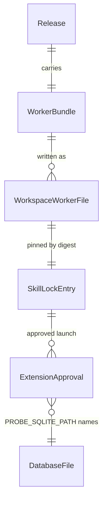

# SQLite probe worker (#235): ship a first-party worker and a guide

## Problem

`vestra probe run` (#690, #700) runs a confirmed read-only statement through an
approved worker, but Verchestra ships no worker. The only SQLite worker is the
test fixture `tests/fixtures/probe-workers/sqlite-worker.mjs`. It imports
repository sources, it is wired into a Workspace by a one-line module that
imports it by an absolute URL (so the bytes behind that URL are not pinned),
and it takes its database path through the node option `--title=`. Probe run
explicitly put "a worker shipped with Verchestra" out of scope
(`.specs/features/probe-run/plan.md`). The protocol a worker must speak,
`verchestra-probe/1`, is written down only in
`.specs/features/out-of-process-probe-host/spec.md`. And no user document
mentions `vestra extension`, `vestra database` or `vestra probe run`; only the
CHANGELOG does. So a tester who installs Verchestra can register a database
and approve a worker, but has no worker to approve and no guide for the
journey.

The owner chose on 2026-10-29 to ship a first-party SQLite worker with a
guide, through a command that writes the worker into the Workspace. The owner
also chose that the worker takes its database file and its component id from
two approved environment variables. The source gives no usage figure; this is
a post-1.0 surface (AD-017).

When this ships, an owner writes Verchestra's own SQLite worker into the
Workspace with one command, reviews and commits it like any other code, and
registers and approves it with the existing commands. The approval names the
database file. `vestra probe run` then reads that file through the worker. A
guide walks the journey from a Workspace to a printed result envelope. AD-037's
rule is unchanged: only Workspace code the owner approved runs.

## Flow

This reuses slice 1's `extension add` and `approve` and their entry and launch
pinning, slice 2a's registration, slice 2b's `probe run`, data-probe's
`SqliteProbeAdapter` and `SqliteReadConnection`, the probe protocol's frame
codec, and the release builder's sealed child bundles, rather than writing a
second implementation of any of them.

1. `vestra probe worker --engine sqlite --entry <path>` -> `apps/vestra-cli` `main.ts` dispatch (exists) -> the probe family's handler (exists; it gains the command, door 1)
2. the handler resolves the worker bundle. In a sealed release that is `bin/sqlite-probe-worker.mjs` (door 3), found the way `resolveMcpBridgeRelay` finds its relay (exists, `release-layout.ts`). In a source checkout it is the same bundle, built by `corepack pnpm build:probe-worker` (door 4)
3. the handler resolves `--entry` against the Workspace's Git top level, as `extension add` resolves `--entry` (exists, `extension-workspace.ts`). It writes the bundle's bytes there, or confirms identical bytes, and prints `path`, `engine`, `digest` and `written`
4. the owner commits the file; `vestra extension add --entry <path>` (exists) pins its digest in the signed skill lock; `vestra extension approve --executable <node> --env PROBE_SQLITE_PATH=<file> --env PROBE_COMPONENT_ID=<extension id>` (exists) pins the launch (door 2)
5. `vestra probe run` (exists) admits the worker and spawns the approved launch through `SpawnedProbeWorker` (exists). The worker reads its two variables (door 2), answers `probe.hello` with its component id and its own digest, and answers identity, session and execute with `SqliteProbeAdapter` over a read-only `SqliteReadConnection` on that file (exist)
6. out: the probe run's envelope, as today; the guide `docs/probe-quick-start.md` (new) walks steps 1-5

## Impact

| Front | What changes |
| --- | --- |
| domain | new term: `first-party worker` - a probe worker whose bytes Verchestra's release carries; once written into a Workspace it is registered, approved and admitted like any Workspace worker |
| package boundary | the probe family composes the SQLite adapter and the probe protocol's frame codec into one bundled worker entry; slice 1's and slice 2a's architecture guards each admit the edge the worker module needs |
| release layout | the sealed release carries a third child bundle beside the launchers, `bin/sqlite-probe-worker.mjs`, sealed as `core-code` (door 3); the sealed closure's pinned bundle list changes with it |
| CLI surface | one command joins the release command manifest, so every pinned command list changes with it (lesson L-019) |
| stored data | none - the written worker is a Workspace file the owner commits; the skill lock and the approval store keep their shapes |
| documentation | a new guide, `docs/probe-quick-start.md`, and links from the site's database discovery and SQLite pages |

## Relations

One-way constraints: a written worker file holds exactly the bytes of the
bundle that wrote it (door 1). An approval names one database file and one
component id, and these are pinned by its launch digest (door 2). No columns
and no types here.

## Surface

| Route | In | Out | Status |
| --- | --- | --- | --- |
| `vestra probe worker` | `--engine`, `--entry` | `path` · `engine` · `digest` · `written` | `exit 0`, `exit 2`, `exit 5` |
| the worker process (`sqlite-probe-worker.mjs`) | `PROBE_SQLITE_PATH`, `PROBE_COMPONENT_ID`, `verchestra-probe/1` frames on stdin | `probe.handshake` · `probe.identity` · `probe.session` · `probe.result.chunk` · `probe.result.end` | `answers the host until it closes`, `exit 5 before the handshake` |

The command also takes `--output json`, as every command does. `--output` is
that global flag (`json` or `human`, `cli.ts`), so the file to write is
`--entry`: the same path `vestra extension add --entry` then registers.

## Landing

| One-way door | Literal shape | Alternative rejected |
| --- | --- | --- |
| 1. Worker command | `vestra probe worker --engine sqlite --entry <path>` in the release command manifest. `<path>` resolves against the Workspace's Git top level as `extension add` resolves `--entry`: inside it, no symlink on the path, never a directory. A missing file is written with the bundle's bytes. A file with the same bytes is left as it is (`written: false`), and a file with other bytes is refused (`VES_PROBE_WORKER_TARGET_CONFLICT`). The command prints `path`, `engine`, `digest` (`sha256:` of the bytes) and `written`. Engines: `sqlite` only | `vestra extension add --builtin sqlite`, which writes and registers in one step: one command would both write code into the repository and sign it into the lock (owner, 2026-10-29); admitting a worker from the release directory: it amends AD-037's entry rule (owner, 2026-10-29); `vestra init --probe-worker`: init's output may depend only on the engine and contract version, and its conflict rule refuses the file a later release changes |
| 2. Worker configuration | the worker reads exactly two variables from its approved environment: `PROBE_SQLITE_PATH`, an absolute path to the database file, and `PROBE_COMPONENT_ID`, the id it gives in its handshake, which must equal the lock's extension id. Missing, empty or relative values make it exit 5 before it answers `probe.hello`. It opens the file only through `SqliteReadConnection` (read-only, `query_only`) | values baked into the written file: each database would need its own file and registration (owner, 2026-10-29); the fixture's node option `--title=`: a node option is a launch quirk, not a contract, and it names the process |
| 3. Release layout | the sealed release carries `bin/sqlite-probe-worker.mjs`, bundled from the worker module with the launchers' option vector, sealed as a `core-code` descriptor, and admitted by the builder's check that a child bundle imports only `node:` modules, as `bin/mcp-tool-bridge.mjs` is | a component copied verbatim under `components/`: the worker runs as an isolated copy, so a file that imports siblings cannot run; a bundle in the npm bootstrap package: the bootstrap carries only the launcher (`PUBLISHED_FILE_ALLOWLIST`) |
| 4. Source-checkout build | `corepack pnpm build:probe-worker` writes the same bundle to `apps/vestra-cli/dist/sqlite-probe-worker.mjs` (git-ignored); in a source checkout `vestra probe worker` copies that file, and without it refuses with `VES_PROBE_WORKER_UNAVAILABLE`, naming the command | bundling inside the command: the CLI would import a build tool; committing the bundle: build output is never canonical (AGENTS.md) |

- Nothing else in this change is hard to reverse.
- Doors 1-3 reach past this feature (the release layout and a worker contract other workers may follow), so `.specs/STATE.md` records them as AD-087 (proposed, human review required).

## Criteria

### S1: an owner writes, approves and runs Verchestra's SQLite worker (P1)

The owner writes the first-party worker into the Workspace, commits it,
registers and approves it naming one SQLite file, and runs a probe through it.

**Acceptance Criteria**

1. WHEN `vestra probe worker --engine sqlite --entry <path>` names a missing file inside the Workspace's Git top level THEN the system SHALL write the worker bundle's bytes there, exit 0, and print `path`, `engine` `sqlite`, `digest` (the `sha256:` of the written bytes) and `written` `true`
2. WHEN the file at `<path>` already holds exactly the bundle's bytes THEN the system SHALL exit 0 with `written` `false` and leave the file unchanged
3. IF the file at `<path>` holds other bytes THEN the system SHALL exit 5 with `VES_PROBE_WORKER_TARGET_CONFLICT` and leave it unchanged
4. IF `<path>` lies outside the Workspace's Git top level, crosses a symlink, or names a directory THEN the system SHALL exit 5 with `VES_PROBE_WORKER_TARGET_INVALID` and write nothing
5. IF `--engine` is not `sqlite` THEN the system SHALL exit 5 with `VES_PROBE_WORKER_ENGINE_UNSUPPORTED` and write nothing
6. IF no worker bundle exists (a source checkout that has not run `build:probe-worker`) THEN the system SHALL exit 5 with `VES_PROBE_WORKER_UNAVAILABLE`, name that command, and write nothing
7. The worker bundle SHALL import only `node:` modules, so it runs as the isolated copy the probe host spawns
8. WHEN a worker written by the command is registered with `vestra extension add`, approved with the absolute path of a Node 24 executable, `PROBE_SQLITE_PATH` naming a SQLite file and `PROBE_COMPONENT_ID` naming the extension id, and probed with `vestra probe run` against a registration of that file THEN the run SHALL end `COMPLETED` with the rows of that file, and the file's bytes SHALL be unchanged
9. IF the approved environment lacks `PROBE_SQLITE_PATH` or `PROBE_COMPONENT_ID`, or either is empty, or the path is not absolute THEN the worker SHALL exit 5 before it answers `probe.hello`, and `vestra probe run` SHALL exit 5, end the run `FAILED` and revoke its grant
10. IF `PROBE_COMPONENT_ID` differs from the lock's extension id THEN admission SHALL refuse the handshake, and `vestra probe run` SHALL exit 5 and end the run `FAILED`
11. The sealed release SHALL carry the worker at `bin/sqlite-probe-worker.mjs` as a `core-code` descriptor, and the sealed `vestra probe worker` SHALL write those bytes
12. WHEN `corepack pnpm build:probe-worker` runs twice on one revision THEN it SHALL write byte-identical bundles

### S2: a tester follows a guide (P1)

**Acceptance Criteria**

13. The guide `docs/probe-quick-start.md` SHALL walk, in order: `vestra init`, `vestra database add`, `vestra probe worker`, committing the worker, `vestra extension add`, `vestra extension approve` with the two variables, `vestra extension check`, `vestra probe run` with a request file, and reading the envelope. It SHALL state that `probe run` runs on Linux and macOS only, that SQLite is the only engine, and that Verchestra delivers no database credential
14. The guide SHALL use, in every `vestra` command line, only a command and options the release command manifest declares
15. The site's read-only database discovery page and SQLite page SHALL link the guide

**Independent test:** on Linux, in a disposable Workspace, through the real launcher:
1. write the worker with `vestra probe worker`, commit it, and register it with `extension add`;
2. approve it with the running Node's absolute path, `PROBE_SQLITE_PATH` naming a SQLite file holding `main.orders`, and `PROBE_COMPONENT_ID` naming the extension id;
3. register that file with `vestra database add`;
4. `vestra probe run` with `SELECT id, status FROM main.orders WHERE id = ?`: type the digest back, see exit 0, an envelope for one row, and the run `COMPLETED`;
5. approve a second reference without `PROBE_SQLITE_PATH`, run again, and see exit 5 with the run `FAILED`.

## Out of scope

| Excluded | Why |
| --- | --- |
| Workers for engines other than SQLite | every other engine needs a credential to connect, and credential delivery is its own feature (owner, 2026-10-29) |
| Keeping an approval across an upgrade | an approval pins the executable's realpath and bytes, and the sealed runtime lives under a per-release directory, so an upgrade needs a new approval (slice 1's existing rule) |
| A worker authoring guide for `verchestra-probe/1` | the guide covers the first-party worker; a protocol guide for third-party workers is a later document |
| Windows | the spawned probe transport is POSIX-only (slice 1, AC 13); the command writes the file on every platform, but only Linux and macOS run it |
| Updating a written worker in place | a file with other bytes is refused (door 1); the owner removes it and writes it again, then registers the new digest |

## Assumptions

| Assumption | Chosen default | Rationale | Confirmed? |
| --- | --- | --- | --- |
| How the worker reaches the Workspace | a command writes it, and the owner commits and registers it (door 1) | owner decision, 2026-10-29 | y |
| Where the worker takes its database and id | two approved environment variables (door 2) | owner decision, 2026-10-29 | y |
| The command's name | `vestra probe worker`, in the probe family | slice 1's door 5 reserved `vestra probe` for running probes, and the worker exists to run them | n |
| The path flag's name | `--entry`, the flag `extension add` takes for the same file | `--output` is the global output-format flag (`cli.ts`) | n |
| The worker's exit code without its configuration | 5, as every Verchestra refusal | the host reports the launch failure, not the worker's own code | n |
| Platforms for the command | every platform writes the file; `probe run` still refuses on Windows | writing a file needs no POSIX transport | n |
| The guide's home | `docs/probe-quick-start.md`, beside `docs/quick-start.md`, linked from the site | the task quick start lives there too | n |

**Open questions:** none - all resolved or logged above.

## Observable

| Surface | Decision | Landing |
| --- | --- | --- |
| `vestra probe worker` | output format and verbosity | existing - the public JSON envelope with `--output json`, human text otherwise; AC 1-2 |
| `vestra probe worker` | every flag and its default | Surface; door 1; no flag has a default |
| `vestra probe worker` | exit codes | Surface; AC 1-6 |
| `vestra probe worker` | what it prints when it fails halfway | AC 3-6 (nothing is written); the write is one file, so there is no half |
| the worker process | what it prints when it fails halfway | AC 9-10 (it exits before the handshake, or admission refuses it; the run ends `FAILED`) |
| `docs/probe-quick-start.md` | structure, tone, depth, and what the reader does next | AC 13-15 - the journey in order, the limits stated, ending at the envelope |
| `vestra --help` and `vestra probe --help` | document the reader acts on | existing - command help from the release command manifest |

## Sources

- Owner decisions, 2026-10-29: ship a first-party SQLite worker and a guide; a command writes it into the Workspace; it takes its database file and component id from two approved environment variables
- `.specs/features/probe-run/plan.md` - Out of scope ("A worker shipped with Verchestra") and the rule that a worker reaches the database with what its approved launch gives it
- `apps/vestra-cli/src/extension/extension-workspace.ts` `resolveEntry` - where an entry may live
- `packages/platform-node/src/probe-launch-digest.ts` and `spawned-probe-worker.ts` - what an approval pins, how a worker is spawned, and which environment names are permitted
- `scripts/t76-build-candidate.mjs` `SEALED_CHILD_ENTRIES` and `apps/vestra-cli/src/release-layout.ts` - how a child bundle ships and is found
- `.specs/features/out-of-process-probe-host/spec.md` - the `verchestra-probe/1` messages a worker answers
