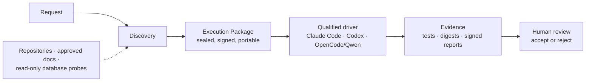
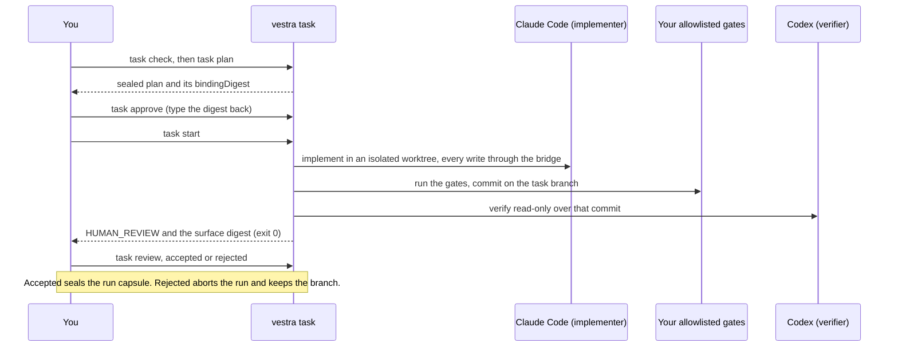
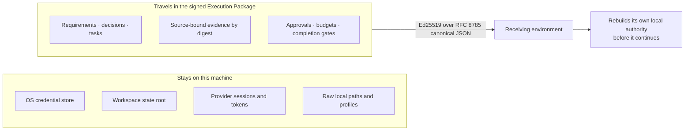
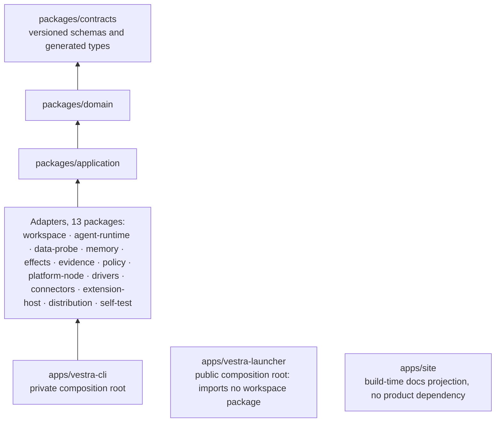

# Verchestra

**Verchestra is a verified AI software-delivery harness.** It turns discovery, planning, implementation, validation, and human approval into portable, signed, and reviewable delivery work.

<p align="center">
  <a href="https://accd.github.io/verchestra/">
    
  </a>
</p>

[](https://github.com/accd/verchestra/actions/workflows/ci.yml)
[](https://accd.github.io/verchestra/)
[](LICENSE)
[](package.json)
[](ROADMAP.md)

> **Status:** `0.0.0-qualification`. T77 is complete and the declared qualification chain is fully verified. The signed 1.0.0 decision is a **reject, recorded as a hold** ([release-decision-1.0.0.md](docs/qualification/release-decision-1.0.0.md)). The npm package `verchestra@0.0.0-qualification.8` is the published beta build. It is not a production release and not 1.0.

The [product site](https://accd.github.io/verchestra/) has the searchable docs. This page is the short version.

## The problem: a chat is not a delivery system

AI-assisted work tends to evaporate into one machine, one model, and one unreviewable conversation. The next developer inherits a transcript, not a contract. Verchestra keeps the durable facts portable and makes every decision that matters explicit.

| Promise                  | What it means                                                                                    |
| ------------------------ | ------------------------------------------------------------------------------------------------ |
| Portable execution       | A signed Execution Package can be resumed by a qualified Claude Code, Codex, or OpenCode/Qwen.    |
| Policy before effects    | Capabilities, approvals, leases, and egress rules are checked before any external effect.        |
| Read-only discovery      | Database probes use bounded, auditable, read-only plans. No hidden writer, ever.                 |
| Evidence, not assertions | Packages, handoffs, reports, and release artifacts bind their source evidence by digest.          |
| Human control            | Independent verification and human review are explicit workflow states, not a CI badge.          |
| Safe repeats             | Effects, Git operations, initialization, recovery, and distribution converge when run twice.      |

SQLite is live-qualified in this repository; the other six database engines are contract-verified here and qualified at the edge.

## How the work flows

Six stops, one contract. The same bounded Execution Package travels the whole way; only the driver changes.



This is the target workflow. The table under *What works today* says which stops have a validation report and which are composed into the installed CLI.

## Beta testers

`0.0.0-qualification` is open to external beta testers. It is still not a
production release and not 1.0: the signed 1.0.0 decision is a hold. Install the
exact build this section names, so every report refers to the same one:

```bash
npx verchestra@0.0.0-qualification.8 --version
```

You need Node 24.14.0 or later for `npx`, and `git` on `PATH`.

| Command family | Label        | What to try                                                                   |
| -------------- | ------------ | ----------------------------------------------------------------------------- |
| `init`         | beta         | Initialize a Workspace in a repository of yours                               |
| `self-test`    | beta         | `self-test --profile smoke` proves the release on your machine                |
| `doctor`       | beta         | A read-only health report; it is not a setup check                            |
| `secret`       | beta         | Store and inspect Workspace credentials in your OS credential store           |
| `task`         | experimental | One governed task, macOS first: follow the [quick start](docs/quick-start.md) |

`task` stays experimental until the supervised live pilot
([#406](https://github.com/accd/verchestra/issues/406)) reaches human review
with real providers; on Linux and Windows it has run only with stand-ins.
Before you run one, read why
[a governed task is not a sandbox](SECURITY.md#a-governed-task-is-not-a-sandbox).

Report a problem with the
[beta tester bug form](https://github.com/accd/verchestra/issues/new?template=tester_bug_report.yml)
and attach what [SUPPORT.md lists](SUPPORT.md#what-to-attach).

## Install and run: no clone, no build, no credential

Verchestra is one npm package with two equivalent binaries, `verchestra` and `vestra`.

```bash
npx verchestra --help
```

The first run does the real work:

- it reads the trust root pinned inside the package and resolves the pinned release through TUF;
- it verifies every component byte, then activates the release transactionally behind a health gate;
- it hands control to the activated release's own Node runtime. Your Node runs only the bootstrap, and an older Node than 24.14.0 is refused with `VES_VESTRA_HOST_UNSUPPORTED`.

Expect a couple of minutes cold and a few seconds once a release is activated. `git` must be on `PATH`, because the Self-Test profiles provision their fixtures with it.

```bash
npx verchestra self-test --profile smoke
```

`self_test.verdict: PASS` with an empty `self_test.failure_codes` means this machine resolved, verified, and activated a signed release and ran the packaged Self-Test inside a disposable trust domain, with no repository checkout anywhere in the journey. Where the managed state lives per OS, how recovery converges, and how to remove everything are on the [install page](https://accd.github.io/verchestra/docs/install-and-run/).

## Run a governed task

One change goes from a request file to a reviewed commit on a task branch. You approve the sealed plan, Claude Code implements it through a mediated tool bridge in an isolated worktree, your allowlisted gates run, Codex verifies read-only, and you review the result. Verchestra never merges; the branch is yours to inspect and merge.



```bash
npx verchestra task check   --request task-request.json
npx verchestra task plan    --request task-request.json
npx verchestra task approve --run-id <runId> --binding-digest <sha256:…>
npx verchestra task start   --run-id <runId>
npx verchestra task status  --run-id <runId>
npx verchestra task review  --run-id <runId> --outcome accepted --surface-digest <sha256:…>
```

The full walkthrough, the one-time subscription setup, a complete request example, and the limits of this build are in [docs/quick-start.md](docs/quick-start.md).

### Credentials

Governed work reads provider credentials from your OS credential store (macOS keychain, Linux Secret Service, Windows Credential Manager), never from an ambient variable or from the session you are logged in to, and injects them only into the child process that needs them. `secret set` reads the value from standard input and never prints it. `doctor --deep` reports `blocked`, not `pass`, until the Workspace's Claude Code credential is bound. Setup, API-key mode, and the per-OS limits are in [quick start section 3](docs/quick-start.md#3-sign-in-the-two-providers-and-bind-the-signing-passphrase).

### Limits of this build

The single-session journey is qualified end to end on macOS only. On Linux it runs in pull-request CI with deterministic stand-ins, the Secret Service included; on Windows one journey runs on the hosted runner with stand-ins. One implementer and one verifier; token and cost ceilings checked when usage is reported; the live pilot is still pending in #406. The full list is in [quick start: limits](docs/quick-start.md#limits-of-this-qualification-build).

### Coordinated runs

A request with `"schemaVersion": 2` can replace the single implementer with several Claude Code and Codex nodes in one governed task: `agent`, `graph`, or `swarm`. Your approval, every write check, your gates, the independent verifier, and your review are unchanged, and only Claude Code nodes write, never two at once. Coordinated runs use your subscriptions and nothing else; they are qualified with stand-ins on all three platforms, and no run with a real subscription has been recorded yet. Examples per mode are in [docs/examples/](docs/examples/); the billing statement, the limits, and suspend and resume are in [quick start: coordinated runs](docs/quick-start.md#coordinated-runs-agent-graph-and-swarm), with the [Windows prerequisites](docs/quick-start.md#windows-prerequisites) beside them.

### Exit codes

Every refusal prints its code and a recovery line; `--output json` returns the
same code in its envelope. This is the decoder ring.

| Exit | Meaning                                                                                                                                                               |
| ---- | --------------------------------------------------------------------------------------------------------------------------------------------------------------------- |
| 0    | Success. For `task start` and `task resume`, the run reached human review.                                                                                            |
| 1    | `doctor` found a failure (`FAIL`), or a `task start` or `task resume` run ended without reaching human review                                                         |
| 2    | An argument is invalid (`VES_CLI_ARGUMENT_INVALID`)                                                                                                                   |
| 3    | The installed release's command manifest is invalid or needs a newer release (`VES_CLI_RELEASE_INCOMPATIBLE`)                                                         |
| 4    | `doctor` is `BLOCKED`, or `task check` found a prerequisite missing: something is not set up                                                                          |
| 5    | Any other refusal, such as `VES_TASK_NOT_CONFIGURED` or a self-test whose verdict is not `PASS`                                                                       |
| 64   | The launcher does not run on this Node, platform, or architecture (`VES_VESTRA_HOST_UNSUPPORTED`)                                                                     |
| 70   | An unexpected failure (`VES_CLI_INTERNAL`), or the launcher could not activate or start the release (`VES_VESTRA_ACTIVATION_UNAVAILABLE`, `VES_VESTRA_LAUNCH_FAILED`) |
| 78   | The launcher's pinned release configuration or trust root is missing or invalid (`VES_VESTRA_INPUTS_*`, `VES_VESTRA_TRUST_ROOT_INVALID`)                              |

## What works today

One honest matrix, mirrored from the typed status the website renders and checked by a drift test, so the two surfaces cannot disagree silently. **available** means runnable today from the published npm package; **qualified** means backed by a public validation report but not yet composed into the CLI; **experimental** means present for evaluation, with interfaces and evidence that may change.

| Capability                                               | Status       | Reference            |
| -------------------------------------------------------- | ------------ | -------------------- |
| Workspace initialization (init preview and apply)        | available    | issue #64 slice A/B  |
| Evidence signing-key lifecycle (persist, rotate, revoke) | qualified    | T68a                 |
| Cost and duration budget enforcement                     | qualified    | T68b                 |
| Declared gate repair loop with human escalation          | qualified    | T68c                 |
| Policy boundary: declarative tests and signed bundles    | qualified    | T68d                 |
| AI driver adapters (Claude Code, Codex, OpenCode/Qwen)   | qualified    | driver qualification |
| Read-only database probes (7 engines, fixture-qualified) | qualified    | database matrix      |
| Signed distribution, activation, and rollback (TUF)      | qualified    | T66-T68              |
| Self-Test trust domain and doctor --deep                 | qualified    | T69-T72              |
| Public regression campaigns and sealed-holdout promotion | qualified    | T73-T74              |
| Platform matrix and release candidate                    | qualified    | T75-T76              |
| 1.0 release decision: a signed hold, not promoted        | qualified    | T77                  |
| Governed task delivery (plan, approve, start, review)    | experimental | #405, #406           |

Rather than take the matrix's word for it, inspect [a real, signed, fixture-generated Execution Package](docs/proof/execution-package.md), regenerable byte for byte from any clean clone with `corepack pnpm proof:generate`. The reports live under [docs/qualification/](docs/qualification/).

## What stays home, what travels

Secrets have a home. They stay in it. The receiver earns its own.



### Not today

- It is not a public production release: the published npm package installs `0.0.0-qualification`, not 1.0.
- It is not a hosted service: everything runs on your own machine.
- It does not transfer provider credentials: a handoff carries evidence and next actions, never sessions or secrets.
- It does not make unapproved paid model calls: a missing provider reports `not configured`, never a silent pass.
- It does not treat CI as human review: acceptance is an explicit human decision recorded as evidence.
- It does not call same-author checks independent verification: that distinction is stated, not blurred.
- It does not expose unqualified commands: the installed CLI advertises `init`, `self-test`, `doctor`, `secret`, and `task` and nothing else.

## Under the hood

Arrows point at what a package may import. Adapters never import each other.



The full map, including the dependency rules a test enforces, is in [docs/repository-map.md](docs/repository-map.md); the runtime boundaries and the trust model are in [docs/architecture.md](docs/architecture.md).

### Work on the source

```bash
git clone https://github.com/accd/verchestra.git
cd verchestra
corepack enable
pnpm install --frozen-lockfile
pnpm gate:quick
```

Node `24.14.0` and pnpm `10.34.5` are the pinned versions. A clean clone is self-describing through the root and scoped `AGENTS.md` files, and `corepack pnpm agent:context -- --json` prints the status, required reads, and gates before anything is installed. [CONTRIBUTING.md](CONTRIBUTING.md) covers setup, Windows notes, the website, and pull requests; [docs/contributing-with-agents.md](docs/contributing-with-agents.md) covers the provider-neutral workflow for coding agents and the AI-readable [llms.txt](llms.txt). The workspace scaffold, including the database-probe scaffold, is in [docs/data-probe-contract.md](docs/data-probe-contract.md).

## Where to next

- [Product website and documentation](https://accd.github.io/verchestra/)
- [Quick start](docs/quick-start.md): the governed task, end to end
- [Roadmap](ROADMAP.md): what is complete and what must happen before 1.0
- [Security](SECURITY.md) and [Support](SUPPORT.md)
- [Versioning](VERSIONING.md): the pre-1.0 release policy
- [GitHub Discussions](https://github.com/accd/verchestra/discussions) for questions and design conversations; beta testers share what they tried in the [Beta feedback thread](https://github.com/accd/verchestra/discussions/670)
- [GitHub Issues](https://github.com/accd/verchestra/issues) for reproducible bugs and scoped proposals
- [Code of Conduct](CODE_OF_CONDUCT.md)

## License

Verchestra is licensed under the [Apache License 2.0](LICENSE).
