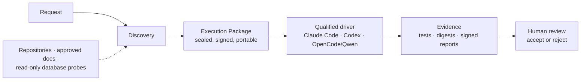
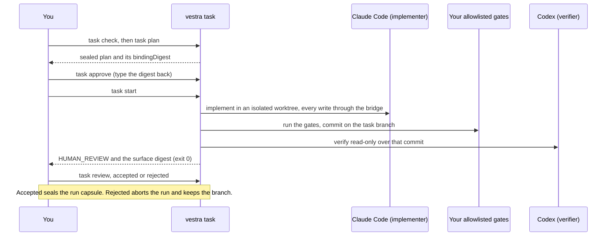
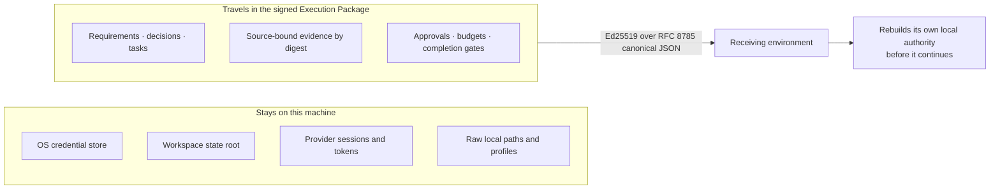

# Verchestra

<p align="center">
  <a href="https://accd.github.io/verchestra/">
    
  </a>
</p>

**Verified AI software delivery, not vibe coding.** You approve the plan, an AI agent implements it in an isolated worktree, a second agent verifies it, and you decide. Every step leaves signed, reviewable evidence.

<p align="center">
  <a href="https://github.com/accd/verchestra/actions/workflows/ci.yml"></a>
  <a href="https://www.npmjs.com/package/verchestra"></a>
  <a href="ROADMAP.md"></a>
  <a href="LICENSE"></a>
</p>

<p align="center">
  <a href="https://accd.github.io/verchestra/"><strong>Docs</strong></a> ·
  <a href="#quick-start">Quick start</a> ·
  <a href="#run-a-governed-task">Governed task</a> ·
  <a href="#status">Status</a> ·
  <a href="https://github.com/accd/verchestra/issues/new?template=tester_bug_report.yml">Report a bug</a> ·
  <a href="https://github.com/accd/verchestra/discussions">Discussions</a>
</p>

> [!NOTE]
> Verchestra is `0.0.0-qualification`: a public beta, not a production release and not 1.0. The signed 1.0.0 decision is a [recorded hold](docs/qualification/release-decision-1.0.0.md).

## Why Verchestra

AI coding agents are fast. What they leave behind is the problem: a transcript on one machine, changes nobody approved, and a "done" nobody can check. Verchestra fixes three things.

**1. The work evaporates with the chat.**
The next developer inherits a conversation, not a contract.
→ *Fix:* the plan, decisions, and evidence travel in a signed [Execution Package](https://accd.github.io/verchestra/docs/concepts/execution-package/) that Claude Code, Codex, or OpenCode/Qwen can resume on another machine.

**2. Agents act before anyone agreed.**
An agent with a shell can write, push, and call anything.
→ *Fix:* [policy is checked before every effect](https://accd.github.io/verchestra/docs/concepts/policy-and-authority/). You approve a sealed plan, every write goes through a mediated bridge in an isolated worktree, and only your allowlisted gates run.

**3. "Done" comes without proof.**
The agent that wrote the code is also the one saying it works.
→ *Fix:* an [independent verifier](https://accd.github.io/verchestra/docs/concepts/independent-verification/) checks the commit read-only, evidence is bound by digest, and [you accept or reject](https://accd.github.io/verchestra/docs/concepts/human-review/). Verchestra never merges for you.

## How it works

One request becomes one reviewed commit. The same signed package travels the whole way; only the driver changes.



| Driver        | Role in a governed task        | Where it is qualified                               |
| ------------- | ------------------------------ | --------------------------------------------------- |
| Claude Code   | Implementer, the only writer   | End to end on macOS; stand-ins on Linux and Windows |
| Codex         | Independent read-only verifier | End to end on macOS; stand-ins on Linux and Windows |
| OpenCode/Qwen | Resumes a portable package     | Driver adapter qualified; not used by `task` yet    |

## Quick start

You need **Node 24.14.0 or later** and `git` on `PATH`. No clone, no build, no credential.

```bash
npx verchestra --help
npx verchestra self-test --profile smoke
```

<p align="center">
  
</p>

`self_test.verdict: PASS` means your machine downloaded, verified, and activated a signed release and ran its own self-test. The first run takes a couple of minutes; later runs take seconds. The package installs two equivalent binaries, `verchestra` and `vestra`.

<details>
<summary><strong>What the first run does</strong></summary>

- It reads the trust root pinned inside the package and resolves the pinned release through TUF.
- It verifies every component byte, then activates the release transactionally behind a health gate.
- It hands control to the activated release's own Node runtime. Your Node runs only the bootstrap, and an older Node than 24.14.0 is refused with `VES_VESTRA_HOST_UNSUPPORTED`.

Where the managed state lives per OS, how recovery works, and how to remove everything are on the [install page](https://accd.github.io/verchestra/docs/install-and-run/).

</details>

## Run a governed task

One change goes from a request file to a reviewed commit on a task branch. You approve the plan by typing its digest back, Claude Code implements it, your gates run, Codex verifies it read-only, and you review the result.

```bash
npx verchestra task check   --request task-request.json
npx verchestra task plan    --request task-request.json
npx verchestra task approve --run-id <runId> --binding-digest <sha256:…>
npx verchestra task start   --run-id <runId>
npx verchestra task status  --run-id <runId>
npx verchestra task review  --run-id <runId> --outcome accepted --surface-digest <sha256:…>
```

The one-time provider setup, a complete request, and the limits of this build are in the [quick start guide](docs/quick-start.md). Request examples for every mode are in [docs/examples/](docs/examples/).

<details>
<summary><strong>The task, step by step</strong></summary>



</details>

## Beta testers

`0.0.0-qualification` is open to external beta testers. Install the exact build
this section names, so every report refers to the same one:

```bash
npx verchestra@0.0.0-qualification.9 --version
```

| Command family | Label        | What to try                                                                   |
| -------------- | ------------ | ----------------------------------------------------------------------------- |
| `init`         | beta         | Initialize a Workspace in a repository of yours                               |
| `self-test`    | beta         | `self-test --profile smoke` proves the release on your machine                |
| `doctor`       | beta         | A read-only health report; it is not a setup check                            |
| `secret`       | beta         | Store and inspect Workspace credentials in your OS credential store           |
| `task`         | experimental | One governed task, macOS first: follow the [quick start](docs/quick-start.md) |

In a Workspace whose Claude Code credential is bound, a healthy installation reports `PASS` and exits `0`. This release does not offer six subsystems, so `doctor` reports each of them as `not-offered` and lists them under `doctor.not_offered_capabilities`: `connectors.available`, `drivers.available`, `policy.enforceable`, `probes.available`, `sandbox.enforced` and `state.durable`. You do not need to do anything for them, and they never change the verdict. `BLOCKED` (exit `4`) means something you can set up is missing, such as that credential.

`task` stays experimental until the supervised live pilot
([#406](https://github.com/accd/verchestra/issues/406)) reaches human review
with real providers. Before you run one, read why
[a governed task is not a sandbox](SECURITY.md#a-governed-task-is-not-a-sandbox).

Report a problem with the
[beta tester bug form](https://github.com/accd/verchestra/issues/new?template=tester_bug_report.yml),
attach what [SUPPORT.md lists](SUPPORT.md#what-to-attach), and share what you
tried in the [Beta feedback thread](https://github.com/accd/verchestra/discussions/670).

## Status

**Runnable today** from the npm package: `init`, `self-test`, `doctor`, `secret`, and the experimental `task`. **Proven but not yet in the CLI:** signing-key lifecycle, budgets, gate repair, the policy boundary, the driver adapters, read-only database probes for 7 engines, and signed distribution. **Next:** a live pilot with real providers, then a fresh 1.0 decision ([roadmap](ROADMAP.md)).

Each label has one meaning. **available** means you can run it today from the published package. **qualified** means a public validation report backs it, but it is not wired into the CLI yet. **experimental** means you can try it, and its interfaces and evidence may change.

<details>
<summary><strong>Full capability matrix</strong> (mirrors the website and is checked by a drift test)</summary>

| Capability                                               | Status       | Reference            |
| -------------------------------------------------------- | ------------ | -------------------- |
| Workspace initialization (init preview and apply)        | available    | issue #64 slice A/B  |
| Evidence signing-key lifecycle (persist, rotate, revoke) | qualified    | T68a                 |
| Cost and duration budget enforcement                     | qualified    | T68b                 |
| Declared gate repair loop with human escalation          | qualified    | T68c                 |
| Policy boundary: declarative tests and signed bundles    | qualified    | T68d                 |
| AI driver adapters (Claude Code, Codex, OpenCode/Qwen)   | qualified    | driver qualification |
| Read-only database probes (7 engines, fixture-qualified) | qualified    | database matrix      |
| Signed distribution, activation, and rollback (TUF)      | qualified    | T66-T68              |
| Self-Test trust domain and doctor --deep                 | qualified    | T69-T72              |
| Public regression campaigns and sealed-holdout promotion | qualified    | T73-T74              |
| Platform matrix and release candidate                    | qualified    | T75-T76              |
| 1.0 release decision: a signed hold, not promoted        | qualified    | T77                  |
| Governed task delivery (plan, approve, start, review)    | experimental | #405, #406           |

SQLite is live-qualified in this repository; the other six database engines are contract-verified here and qualified at the edge. The reports live under [docs/qualification/](docs/qualification/).

</details>

Don't take the table's word for it. Inspect [a real, signed Execution Package](docs/proof/execution-package.md); you can regenerate it byte for byte from a clean clone with `corepack pnpm proof:generate`.

### What it is not

- **Not 1.0 and not production-ready.** The npm package installs `0.0.0-qualification`.
- **Not a hosted service.** Everything runs on your machine.
- **Not a credential courier.** A handoff carries evidence and next actions, never sessions or secrets.
- **Not a silent pass.** A missing provider reports `not configured`, and no paid model call runs without approval.
- **Not CI pretending to be review.** Acceptance is an explicit human decision, recorded as evidence.

<p align="right"><a href="#verchestra">back to top ↑</a></p>

## Reference

<details>
<summary><strong>Exit codes, credentials, limits, coordinated runs, and what travels</strong></summary>

### Exit codes

Every refusal prints its code and a recovery line; `--output json` returns the
same code in its envelope.

| Exit | Meaning                                                                                                                                                               |
| ---- | --------------------------------------------------------------------------------------------------------------------------------------------------------------------- |
| 0    | Success. For `task start` and `task resume`, the run reached human review.                                                                                            |
| 1    | `doctor` found a failure (`FAIL`), or a `task start` or `task resume` run ended without reaching human review                                                         |
| 2    | An argument is invalid (`VES_CLI_ARGUMENT_INVALID`)                                                                                                                   |
| 3    | The installed release's command manifest is invalid or needs a newer release (`VES_CLI_RELEASE_INCOMPATIBLE`)                                                         |
| 4    | `doctor` is `BLOCKED`, or `task check` found a prerequisite missing: something is not set up                                                                          |
| 5    | Any other refusal, such as `VES_TASK_NOT_CONFIGURED` or a self-test whose verdict is not `PASS`                                                                       |
| 64   | The launcher does not run on this Node, platform, or architecture (`VES_VESTRA_HOST_UNSUPPORTED`)                                                                     |
| 70   | An unexpected failure (`VES_CLI_INTERNAL`), or the launcher could not activate or start the release (`VES_VESTRA_ACTIVATION_UNAVAILABLE`, `VES_VESTRA_LAUNCH_FAILED`) |
| 78   | The launcher's pinned release configuration or trust root is missing or invalid (`VES_VESTRA_INPUTS_*`, `VES_VESTRA_TRUST_ROOT_INVALID`)                              |

### Credentials

Governed work reads provider credentials from your OS credential store (macOS keychain, Linux Secret Service, Windows Credential Manager). It never reads them from an ambient variable or from the session you are logged in to, and it injects them only into the child process that needs them. `secret set` reads the value from standard input and never prints it. `doctor --deep` reports `blocked`, not `pass`, until the Workspace's Claude Code credential is bound. Setup, API-key mode, and the per-OS limits are in [quick start section 3](docs/quick-start.md#3-sign-in-the-two-providers-and-bind-the-signing-passphrase).

### Limits of this build

The single-session journey is qualified end to end on macOS only. On Linux it runs in pull-request CI with deterministic stand-ins, the Secret Service included; on Windows one journey runs on the hosted runner with stand-ins. One implementer and one verifier; token and cost ceilings are checked when usage is reported. The full list is in [quick start: limits](docs/quick-start.md#limits-of-this-qualification-build).

### Coordinated runs

A request with `"schemaVersion": 2` can replace the single implementer with several Claude Code and Codex nodes in one governed task: `agent`, `graph`, or `swarm`. Your approval, every write check, your gates, the independent verifier, and your review are unchanged, and only Claude Code nodes write, never two at once. Coordinated runs use your subscriptions and nothing else; they are qualified with stand-ins on all three platforms, and no run with a real subscription has been recorded yet. See [quick start: coordinated runs](docs/quick-start.md#coordinated-runs-agent-graph-and-swarm) and the [Windows prerequisites](docs/quick-start.md#windows-prerequisites).

### What stays home, what travels

Secrets stay on your machine. The receiving environment rebuilds its own authority.



</details>

## Contributing

```bash
git clone https://github.com/accd/verchestra.git
cd verchestra
corepack enable
pnpm install --frozen-lockfile
pnpm gate:quick
```

The pinned versions are Node `24.14.0` and pnpm `10.34.5`. A clean clone describes itself through the root and scoped `AGENTS.md` files. `corepack pnpm agent:context -- --json` prints the status, the required reads, and the gates, and it works before anything is installed. It is built with TypeScript on Node 24 and pnpm workspaces, distributed through TUF, and signs evidence with Ed25519 over RFC 8785 canonical JSON.

- [CONTRIBUTING.md](CONTRIBUTING.md): setup, Windows notes, the website, and pull requests.
- [Contributing with agents](docs/contributing-with-agents.md): the provider-neutral workflow for coding agents, plus [llms.txt](llms.txt).
- [Repository map](docs/repository-map.md) and [architecture](docs/architecture.md): package boundaries, dependency rules, and the trust model.

## Community

- [Product website and documentation](https://accd.github.io/verchestra/)
- [Roadmap](ROADMAP.md) · [Changelog](CHANGELOG.md) · [Versioning](VERSIONING.md)
- [Security](SECURITY.md) · [Support](SUPPORT.md) · [Code of Conduct](CODE_OF_CONDUCT.md)
- [GitHub Discussions](https://github.com/accd/verchestra/discussions) for questions and design conversations; [GitHub Issues](https://github.com/accd/verchestra/issues) for reproducible bugs and scoped proposals

<p align="right"><a href="#verchestra">back to top ↑</a></p>

## License

Verchestra is licensed under the [Apache License 2.0](LICENSE).
