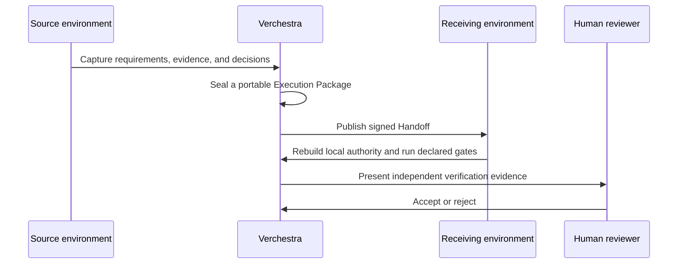

A handoff transfers durable work, not hidden authority.

For example, one engineer can complete discovery and specification with Claude Code. They commit the Execution Package and publish the agreed tracker state. A second engineer pulls the repository and continues with OpenCode/Qwen.

The receiving environment:

1. verifies package and source digests;
2. resolves its own qualified driver;
3. rebuilds local credentials and capabilities;
4. resumes from the last idempotent checkpoint;
5. appends evidence without rewriting accepted history.

The sequence below is the target workflow a handoff follows end to end; today `init` is the part composed into the CLI, and the other steps are qualified piece by piece in the [qualification reports](/verchestra/docs/qualification/).

Provider-specific prompts are never the handoff contract. Jira or Confluence may expose a human-readable projection, but the signed repository package remains the executable source of truth.
